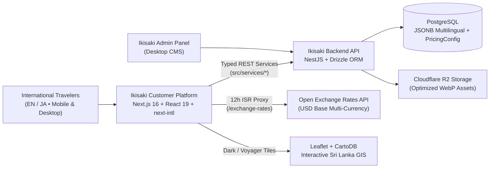

<div align="center">


# Ikisaki Tours — Luxury Sri Lanka Travel & Booking Platform

**Next-Generation Bilingual Travel, Dynamic Group Pricing & Bespoke Itinerary Platform for [www.ikisakitours.com](https://www.ikisakitours.com)**

[](https://nextjs.org/)
[](https://react.dev/)
[](https://www.typescriptlang.org/)
[](https://tailwindcss.com/)
[](https://next-intl.dev/)
[](https://vercel.com/)

[Live Website](https://www.ikisakitours.com) · [Japanese Site (`/ja`)](https://www.ikisakitours.com/ja) · [Global SEO Blueprint](./SEO_BLUEPRINT.md) · [Admin Panel](https://ikisakitours-admin-panel.vercel.app)

</div>

---

## Table of Contents

- [Overview](#overview)
- [System Architecture](#system-architecture)
- [Application Routes & Modules](#application-routes--modules)
- [Core Engineering Highlights](#core-engineering-highlights)
  - [1. Dynamic Group Pricing & Multi-Step Luxury Booking Review Modal](#1-dynamic-group-pricing--multi-step-luxury-booking-review-modal)
  - [2. Bilingual i18n (`EN` / `JA`), BudouX Typography & Live Multi-Currency](#2-bilingual-i18n-en--ja-budoux-typography--live-multi-currency)
  - [3. Auth-Safe Draft Persistence, Geo-Detection & WebP Media Pipeline](#3-auth-safe-draft-persistence-geo-detection--webp-media-pipeline)
  - [4. 5-Pillar Enterprise Global SEO Architecture](#4-5-pillar-enterprise-global-seo-architecture)
  - [5. Interactive UX Systems, Chat Concierge & Compliance](#5-interactive-ux-systems-chat-concierge--compliance)
- [Custom UI Controls & React Hooks](#custom-ui-controls--react-hooks)
- [API Service Layer Reference](#api-service-layer-reference)
- [Tech Stack](#tech-stack)
- [Project Structure](#project-structure)
- [Getting Started](#getting-started)
- [Deployment (Vercel)](#deployment-vercel)
- [Production Readiness Checklist](#production-readiness-checklist)
- [Credits & License](#credits--license)

---

## Overview

**Ikisaki Tours** is a luxury, enterprise-grade customer travel platform engineered for international travelers (with primary focus on the **United States, United Kingdom, Europe, Australia, and Japan**) booking private Sri Lanka journeys, chauffeur-driven tours, airport transfers, and tailor-made island itineraries.

Built with **Next.js 16 (App Router, Turbopack, React Compiler)**, **React 19**, and **Tailwind CSS v4**, the platform pairs a signature **Lanka Black & Gold** aesthetic with real-time dynamic group pricing, a multi-step booking review modal with configurable add-ons, native **English (`EN`)** and **Japanese (`JA`)** localization powered by Google **BudouX**, interactive **Leaflet + CartoDB** GIS mapping, live 12-hour ISR currency conversion, automatic geo-location detection, auth-safe form draft persistence, and a 5-pillar enterprise SEO suite built for Google Global and Google/Yahoo! Japan.

> [!TIP]
> **Full-Stack Ecosystem:** All tour packages, group discount tiers, passenger pricing rules, tour add-ons, closed availability dates, destinations, blogs, FAQs, legal documents, user VIP/access controls, and review replies are managed live through the companion **[Ikisaki Tours Admin Panel](https://ikisakitours-admin-panel.vercel.app)**.

> [!IMPORTANT]
> **Multilingual Precision:** Every customer-facing label, pricing tier badge, validation error, image `alt` attribute, and SEO metadata field is localized across **25 modular dictionary files per locale** (`en` and `ja`), eliminating mixed-language leaks on Japanese routes.

---

## System Architecture



---

## Application Routes & Modules

| Module | Route(s) | Capabilities & Features |
| :--- | :--- | :--- |
| **Home & Discovery** | `/[locale]` | Cinematic hero with OmniSearch, curated tours showcase, experience highlights, private vehicle fleet, transfers preview, cultural events with `UniversalPlayer`, travel journal preview, client testimonials & contact CTA |
| **Tour Explorers** | `/[locale]/tours/one-day`, `/[locale]/tours/multi-days` | Interactive tour catalog with category, duration, rating, and price filtering, localized conversion badges (`packageBadge.ts`), and dynamic per-person starting rates |
| **Tour Booking & Reviews** | `/[locale]/booking/one-day-tours/[slug]`, `/[locale]/booking/multi-days-tours/[slug]`, `.../reviews` | 17 specialized detail sections (`BookingHeader`, `BookingGallery`, `DescriptionSection`, `HighlightsSection`, `ActivityDetails`, `ItinerarySection` with dynamic `meals[]` & `accommodation[]`, `CoveredCitiesRoute` with `#route-map` hash sync, `CoveredDestinations`, `IncludesSection`, `EssentialsSection`, `TourCustomization`, `StoryBanner`, `ReviewsSection`), sticky `BookingNavigation`, dynamic pricing widget, multi-step **Luxury Booking Review Modal**, mobile `StickyBookingBar`, package likes, and verified photo reviews with admin replies |
| **Chauffeur & Bespoke Services** | `/[locale]/services/bespoke-travel`, `/[locale]/services/private-vehicle`, `/[locale]/services/transfers` | Tailor-made journey planner, private chauffeur charters, and airport/intercity transfers with live backend rate cards, vehicle selectors, multilingual service guidelines, and auth-safe draft recovery |
| **Destinations & GIS Map** | `/[locale]/destination`, `/[locale]/destination/[slug]` | Interactive **Leaflet + CartoDB** Sri Lanka map (Dark & Light visual moods, custom gold pins, province filters) plus destination guides with GPS coordinates, climate info & galleries |
| **Cultural Events** | `/[locale]/events`, `/[locale]/events/[slug]` | Sri Lanka heritage festivals (Kandy Esala Perahera, Vesak, Sinhala & Tamil New Year) with `UniversalPlayer` video streaming and high-resolution event sliders |
| **Travel Journal (Blog)** | `/[locale]/blog`, `/[locale]/blog/[slug]` | Multilingual Sri Lanka travel guides (ETA visa, packing, currency, etiquette, Ayurveda) with category explorer, article likes, and full-screen galleries |
| **Full-Screen Galleries** | `/[locale]/gallery/[slug]`, `/[locale]/gallery/destination/[slug]` | Full-screen `GalleryLightbox` viewer with thumbnail navigation for tours, blogs, and destinations |
| **Auth, Profile & Access Gate** | `/[locale]/login`, `/signup`, `/auth-gateway`, `/confirm-email`, `/password-change`, `/profile`, `/access-restricted` | Email/password & Social OAuth login, OTP verification, password strength meter (`usePasswordStrength`), profile dashboard with interactive avatar cropper (`react-easy-crop` → WebP), security settings, referral panel, and `AccessGate` for suspended accounts |
| **Support, Legal & System** | `/[locale]/about`, `/contact`, `/faq`, `/testimonials`, `/legal/[[...slug]]`, `/[locale]/[...catchAll]` | Company story & leadership, Contact Us inquiry form, accordion FAQs, customer testimonials writer, CMS-driven Privacy/Terms legal pages, and localized **Unsupported Language / 404** (`NotFoundUI`) |
| **Platform Endpoints** | `/exchange-rates`, `/robots.txt`, `/sitemap.xml` | 12-hour ISR USD exchange rate proxy, dynamic crawler directives, and timeout-guarded multilingual XML sitemap |

---

## Core Engineering Highlights

### 1. Dynamic Group Pricing & Multi-Step Luxury Booking Review Modal

Powered by [`pricingUtils.ts`](./src/services/Booking/packageDetails/pricingUtils.ts), [`useBookingWidget.ts`](./src/hooks/Booking/useBookingWidget.ts), [`BookingWidget.tsx`](./src/components/booking/BookingWidget.tsx), [`BookingModal.tsx`](./src/components/booking/BookingModal.tsx), and [`useValidationForm.ts`](./src/hooks/useValidationForm.ts):

- **Real-Time Group Discount Tiers**: Dynamically calculates per-person rates across Sri Lanka private vehicle capacities (Solo `1`, Couple `2`, Small Group `3–4`, Medium Group `5–7`, Large Group `8–15`, Coach `16+`) with fully localized tier headers (`Group Rate (3–4 Guests)` / `グループ料金（3〜4名様）`).
- **Passenger Pricing & Validation Rules**:
  - Supports `auto_tier` or `fixed` couple pricing (2 adults per pair), `percentage` (e.g. 50% off) or `fixed` child rates, and configurable infant fees (default Free).
  - Enforces adult/couple presence (`adultRequired` in both `en` & `ja`) so travelers cannot submit children/infants-only bookings in either `BookingWidget` or `BookingModal`.
- **Multi-Step Luxury Booking Review Modal**:
  - Clicking **Check Availability** validates inputs, checks auth (persisting a draft if signed out), auto-closes the mobile `StickyBookingBar` sheet, and opens a portal-mounted luxury review modal (`createPortal`) with full desktop & mobile touch scroll-lock.
  - Travelers can update **Journey Date** (backed by live closed-date calendar availability) and **Traveler Counts**, toggle **Details** on multilingual **Tour Add-Ons & Supplements**, and independently select quantities for `per_person` (clamped to `totalPax`) and `per_room` add-ons while `per_booking` / `flat` fees apply cleanly as one-time charges.
  - Displays an itemized live **Estimated Total** breakdown before final **Book Now** confirmation.

### 2. Bilingual i18n (`EN` / `JA`), BudouX Typography & Live Multi-Currency

- **Subpath Locale Routing (`next-intl` v4 + [`src/proxy.ts`](./src/proxy.ts))**: Clean `/en/...` and `/ja/...` routes powered by **25 modular dictionary files per locale** under [`src/languages/en/`](./src/languages/en) and [`src/languages/ja/`](./src/languages/ja).
- **BudouX Japanese Line-Breaking**: Integrates Google's [`budoux`](https://github.com/google/budoux) ML word segmenter ([`src/lib/japaneseText.ts`](./src/lib/japaneseText.ts)) across all Japanese messages to prevent awkward mid-word wraps on mobile and tablet screens.
- **Geo-Location Language Prompt & Unsupported Locale UX**: Detects visitor locale (`useUserLocation`), displays a localized `LanguagePromptToast` after preloader completion, and routes unsupported language codes into a friendly localized `NotFoundUI` with instant EN/JA recovery buttons.
- **Live Multi-Currency (`CurrencyContext` + `/exchange-rates`)**: Converts all tour rates, tier breakdowns, add-ons, and service pricing live using USD-base rates cached for 12 hours via Next.js ISR ([`src/app/exchange-rates/route.ts`](./src/app/exchange-rates/route.ts)), synchronized automatically with language switches.

### 3. Auth-Safe Draft Persistence, Geo-Detection & WebP Media Pipeline

- **Zero-Data-Loss Draft Recovery (`src/utils/draft/`)**: Five dedicated draft modules (`bookingDraft.ts`, `bookingReviewDraft.ts`, `contactDraft.ts`, `reviewDraft.ts`, `servicesDraft.ts`) preserve in-progress user selections across `AuthRequiredModal` login redirects and automatically restore them on return (including reopening the mobile `StickyBookingBar` drawer when needed).
- **Automatic Country & Phone Code Detection**: `useUserLocation` + `LocationDetectionFeedback` + `react-phone-number-input` auto-detect visitor country and dial codes across signup, profile, contact, and service forms with mismatch notifications.
- **Client-Side Cropping & WebP Conversion**: Interactive avatar cropping (`react-easy-crop`, [`cropImage.ts`](./src/utils/cropImage.ts)) and automatic client-side `.webp` compression ([`convertToWebp.ts`](./src/utils/convertToWebp.ts)) before uploading profile photos or guest review images.
- **Session-Cached Media & Optimized Brand Assets**: `LoadingImage` caches loaded image URLs in `sessionStorage` for instant repeat transitions; `LoadingVideo` handles video buffers; [`public/Layout-Icons/`](./public/Layout-Icons) houses the transparent header logo (`logo-transparent.webp`), edge-to-edge rounded dark-gold multi-size favicons (`favicon.ico`, `favicon.png`), preloader crest (`image-600x600.webp`), and OpenGraph/Twitter WebP banners (`image-1200x630.webp`, `image-600x315.webp`).

### 4. 5-Pillar Enterprise Global SEO Architecture

Documented in [`SEO_BLUEPRINT.md`](./SEO_BLUEPRINT.md) and implemented across [`src/components/seo/schemas.ts`](./src/components/seo/schemas.ts), [`src/app/robots.ts`](./src/app/robots.ts), and [`src/app/sitemap.ts`](./src/app/sitemap.ts):


- **9 Schema.org JSON-LD Builders**: `TravelAgency`, `TouristTrip`/`Product`, `FAQPage`, `BlogPosting`, `BreadcrumbList`, `TouristDestination`, `Service`, `Event`, and `ContactPage`.
- **Dynamic Multilingual Sitemap**: Generates canonical URLs with `withTimeout` safety guards across static pages, tours, package reviews, destinations, blogs, and cultural events.
- **Hreflang & Canonical Alternates**: Emits absolute `canonical`, `en`, `ja`, and `x-default` alternates on every public route.

### 5. Interactive UX Systems, Chat Concierge & Compliance

- **Zero-Shift 60fps Minimalist Preloader & Event Bus**: [`Preloader.tsx`](./src/components/ui/Preloader.tsx) uses a cookie-gated (`preloader_seen`) pure-GPU breathing crest animation on a fixed `100vw` stage (preventing scrollbar layout shifts) and dispatches `preloaderFinished` so `FloatingWidgets`, `CookieConsent`, and `LanguagePromptToast` coordinate cleanly without race conditions.
- **Omnichannel Chat Concierge & Tab Alerts**: `FullChatWidget` combines automated bot help (`BotChatInterface`), direct email concierge (`ChatMailForm`), localized WhatsApp handoff, and live browser tab notifications via [`useDocumentTitleNotification.ts`](./src/hooks/useDocumentTitleNotification.ts).
- **Promotional Campaigns, Mobile Polish & Compliance**: Includes `PromoModal` with animated `ConfettiRain`, `IOSZoomFix` (`useDisableIOSZoom`) preventing Safari form auto-zoom, `ShareButton` (Web Share API + clipboard fallback), `ProgressBarProvider` (`nextjs-toploader`), `CookieConsent` + `GlobalCookieModal`, and `AccessGate` / `AccessRestricted` account enforcement.

---

## Custom UI Controls & React Hooks

| Category | Key Modules | Purpose |
| :--- | :--- | :--- |
| **Luxury Form Pickers** | `CustomDatePicker`, `CustomTimePicker`, `TourDurationPicker`, `TravelerPicker`, `CustomCountrySelect`, `CustomSelect` | Dark/gold themed controls with live closed-date tooltips, tour-type availability rules, and searchable country selection |
| **Interactive Media & Feedback** | `LoadingImage`, `LoadingVideo`, `UniversalPlayer`, `GalleryLightbox`, `PromoModal`, `ConfettiRain`, `ToastContext` | Session-cached image shimmer, video playback, full-screen lightbox, promotional confetti modal, and global toast alerts |
| **Core Utility Hooks** | `useBookingWidget`, `useValidationForm`, `useAvailability`, `useUserLocation`, `usePasswordStrength`, `useDocumentTitleNotification`, `useAutoResizeTextarea`, `useDisableIOSZoom` | Shared booking state, bilingual form validation, closed-date availability, geo-IP lookup, password strength rules, dynamic tab alerts, and iOS viewport protection |

---

## API Service Layer Reference

All backend communication lives in strongly typed modules under [`src/services/`](./src/services):

| Domain | Service Module(s) | Purpose |
| :--- | :--- | :--- |
| **Tour Packages & Booking** | `Booking/packageDetails/packageDetailsService.ts`, `Booking/bookingWidgetService.ts`, `Booking/packageLike/packageLikeService.ts`, `tours/packageSummaryService.ts` | Fetch tour summaries & full details (`pricingConfig`, itineraries), create bookings, and toggle package likes |
| **Package & Site Reviews** | `Booking/PackageReviewService.ts`, `Booking/packageAllReview/FetchReviewService.ts`, `Booking/packageSummaryReview/ReviewSummaryService.ts`, `testimonials/fetchReviewsServices.ts`, `testimonials/writeReviewService.ts` | Submit and fetch package reviews (with photo uploads & admin replies) and global website testimonials |
| **Date Availability** | `date-availability/availabilityService.ts` | Fetch closed booking dates, tour-type closure rules, and localized calendar notes |
| **Chauffeur & Bespoke Services** | `services/bespokeService.ts`, `services/privateVehicleService.ts`, `services/transferService.ts`, `services/service-pricing/servicePricingService.ts`, `services/note/serviceNotesService.ts` | Submit custom tour, private chauffeur, and airport transfer requests; fetch live rate cards & multilingual guidelines |
| **Destinations, Blogs & FAQs** | `destinations/fetchDestinationServices.ts`, `blogs/fetchBlogServices.ts`, `faqs/faqService.ts` | Fetch destination hubs & GPS coordinates, travel journal posts & likes, and localized FAQs |
| **Auth & User Profile** | `auth/authService.ts`, `profile/profileService.ts` | Login, signup, social OAuth, OTP email confirmation, password recovery, profile/avatar updates & security settings |
| **Engagement & Compliance** | `Contact/contactService.ts`, `ChatWidget/chatMailService.ts`, `Footer/newsletterService.ts`, `cookies/cookieService.ts`, `legal/legalDocsService.ts` | Contact inquiries, chat email handoff, newsletter signups, cookie consent logging & CMS legal documents |

---

## Tech Stack

| Layer | Technology |
| :--- | :--- |
| **Framework** | Next.js `16.2.10` (App Router, Turbopack, React Compiler via `babel-plugin-react-compiler`) |
| **UI Library & Styling** | React `19.2.4`, Tailwind CSS `v4` (`@tailwindcss/postcss`), Lucide React, React Icons |
| **Language** | TypeScript `5.x` |
| **Localization & Typography** | `next-intl` `4.13`, Google `budoux`, Google Fonts (`Playfair Display`, `Plus Jakarta Sans`, `Noto Sans JP`, `Noto Serif JP`) |
| **Motion & Interactive UX** | Framer Motion `12.42`, `nextjs-toploader`, `react-easy-crop`, `react-phone-number-input` |
| **Interactive GIS Mapping** | Leaflet `1.9`, React Leaflet `5.0`, CartoDB Basemaps |
| **Code Quality & Tooling** | ESLint `9` (`eslint-config-next` `16.2.10`), `knip` (unused code/export analysis), `google-translate-api-x` |
| **Backend Ecosystem** | NestJS + Drizzle ORM + PostgreSQL + Cloudflare R2 (`NEXT_PUBLIC_API_URL`) |
| **Deployment** | Vercel |

---

## Project Structure

<details>
<summary><strong>Click to expand repository directory tree</strong></summary>

```text
ikisakitours/
├── README.md                              # Project documentation (GFM)
├── SEO_BLUEPRINT.md                       # Global 5-pillar SEO master specification
├── next.config.ts                         # Next.js 16 + next-intl + React Compiler config
├── package.json
├── public/
│   ├── Layout-Icons/                      # Favicons, transparent header logo, preloader & OG WebP assets
│   ├── images/                            # Active brand video & fallback assets
│   └── ikisaki-images/                    # Localized static brand graphics
└── src/
    ├── proxy.ts                           # next-intl locale middleware (excludes api & exchange-rates)
    ├── app/
    │   ├── exchange-rates/route.ts        # 12-hour ISR USD exchange rates proxy
    │   ├── favicon.ico                    # Full-bleed rounded dark-gold Sigiriya badge
    │   ├── globals.css                    # Tailwind v4 tokens, gold gradients & animations
    │   ├── robots.ts                      # Dynamic robots.txt crawler directives
    │   ├── sitemap.ts                     # Dynamic multilingual XML sitemap generator
    │   └── [locale]/
    │       ├── layout.tsx                 # Root localized layout, fonts, metadata, icons, providers
    │       ├── not-found.tsx              # Localized 404 & Unsupported Language UI
    │       ├── [...catchAll]/page.tsx     # Catch-all handler routing into localized not-found
    │       ├── access-restricted/         # Suspended account notice page
    │       ├── (auth)/                    # login, signup, auth-gateway, confirm-email, password-change
    │       ├── (pages)/                   # Home, about, blog, booking, contact, destination, events, faq, legal, profile, services, testimonials, tours
    │       └── gallery/                   # Full-screen tour, blog & destination photo galleries
    ├── components/                        # Modular feature components (booking, Destinations, home, layout, profile, seo, services, tours, ui, ...)
    ├── config/                            # Contact & brand configuration
    ├── context/                           # AuthContext, CurrencyContext, ToastContext
    ├── data/                              # Navigation, languages/currencies, vehicles, events & fallback datasets
    ├── hooks/                             # Custom hooks (useBookingWidget, useValidationForm, useAvailability, useUserLocation, ...)
    ├── languages/
    │   ├── en/                            # 25 English dictionary modules
    │   └── ja/                            # 25 Japanese dictionary modules
    ├── lib/                               # i18n.ts, i18nNavigation.ts, japaneseText.ts (BudouX)
    ├── services/                          # Strongly typed REST API service layer
    └── utils/                             # Draft persistence (draft/*), WebP converter, cropper, badges, cookie & redirect helpers
```

</details>

---

## Getting Started

### Prerequisites

- **Node.js** `>= 20.x`
- **npm** `>= 10.x` (or `pnpm`)
- Access to the **Ikisaki Tours Backend API**

### 1. Clone & Install

```bash
git clone https://github.com/ikisakitours/ikisakitours.git
cd ikisakitours
npm install
```

### 2. Configure Environment Variables

Create `.env.local` in the project root:

| Variable | Required | Description |
| :--- | :---: | :--- |
| `NEXT_PUBLIC_API_URL` | Yes | Base URL of the Ikisaki Tours NestJS Backend API (falls back to `/api` if omitted) |
| `NEXT_PUBLIC_CARTO_API_KEY` | Optional | CartoDB API key for interactive Leaflet dark/voyager destination map tiles |

```env
NEXT_PUBLIC_API_URL=https://ikisakitours-backend.vercel.app
NEXT_PUBLIC_CARTO_API_KEY=your_carto_api_key_here
```

> [!CAUTION]
> Never commit `.env.local` or secret keys to version control. Always configure production secrets securely in Vercel Environment Variables.

### 3. Run, Type-Check & Build

```bash
# Start development server (http://localhost:3000)
npm run dev

# Run strict TypeScript type check
npx tsc --noEmit

# Run ESLint
npm run lint

# Create optimized production build & run server
npm run build
npm run start
```

---

## Deployment (Vercel)

1. Import the repository into **Vercel** and select the **Next.js** framework preset.
2. Add `NEXT_PUBLIC_API_URL` (and `NEXT_PUBLIC_CARTO_API_KEY` if used) under **Settings → Environment Variables**.
3. Deploy — Vercel automatically builds all localized App Router routes with Turbopack, enables the `/exchange-rates` 12-hour ISR cache, and generates `/robots.txt` and `/sitemap.xml`.

---

## Production Readiness Checklist

- [x] Next.js `16.2.10` + React `19.2.4` + React Compiler + Tailwind CSS `v4` verified (`npx tsc --noEmit` & `npm run lint` passing with `0` errors)
- [x] Native `EN` & `JA` localization (`25` modular dictionary files per locale) with Google **BudouX** Japanese phrase segmentation
- [x] Dynamic group pricing (`pricingConfig`), adult/couple traveler validation, and multi-step **Luxury Booking Review Modal** with `per_person` / `per_room` / `per_booking` add-ons
- [x] Auth-safe draft save & restore across bookings, services, reviews, and contact inquiries
- [x] 5-pillar enterprise SEO (`robots.ts`, `sitemap.ts`, 9 Schema.org JSON-LD builders, `hreflang` alternates, OpenGraph & Twitter cards)
- [x] Transparent cropped header crest, full-bleed rounded dark-gold favicon badge, and zero-shift 60fps minimalist preloader

---

## Credits & License

| Role | Details |
| :--- | :--- |
| **Client** | [Ikisaki Tours (Pvt) Ltd](https://www.ikisakitours.com) |
| **Powered By** | Aetheria Labs |
| **Engineered By** | `Pramod_Siriwardhana` |
| **License** | Proprietary — All Rights Reserved ([`LICENSE`](./LICENSE)) |

> [!NOTE]
> **Copyright © 2026 Ikisaki Tours (Pvt) Ltd. All rights reserved.**  
> This repository and its source code, design assets, and localization dictionaries are proprietary and confidential. Unauthorized copying, redistribution, modification, or commercial use is strictly prohibited without prior written consent from Ikisaki Tours (Pvt) Ltd. See [`LICENSE`](./LICENSE) for full terms.
