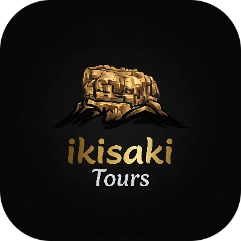
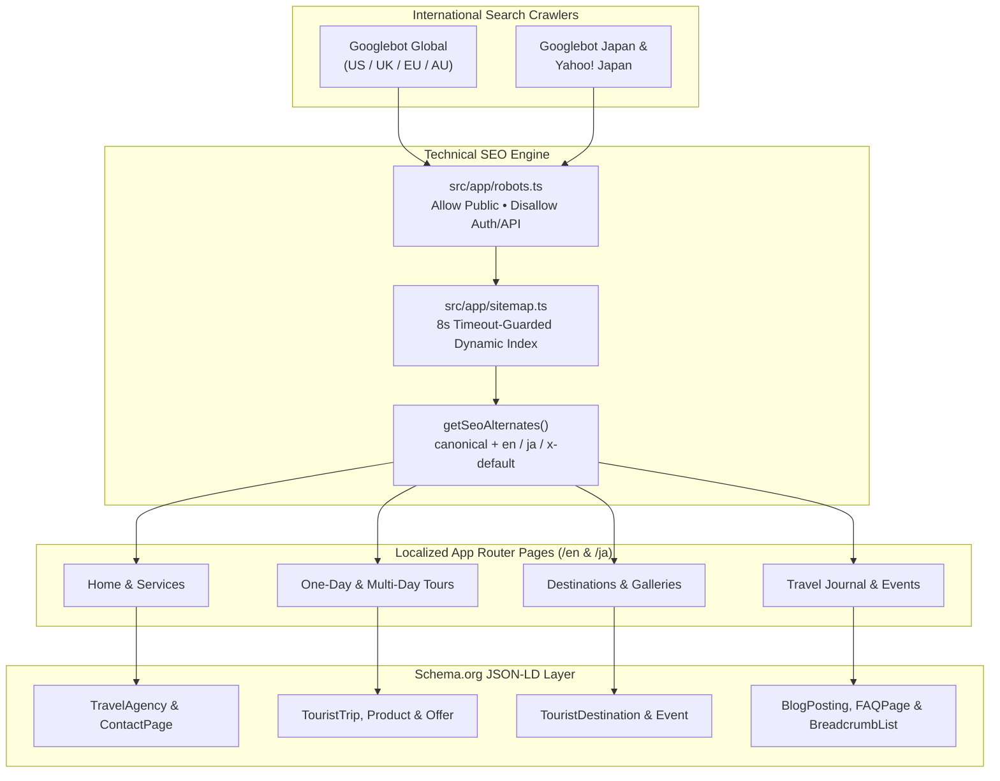
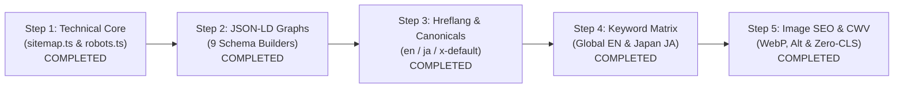

<div align="center">



# Ikisaki Tours — Global SEO Master Blueprint & Architecture

**Enterprise 5-Pillar International SEO Specification for [www.ikisakitours.com](https://www.ikisakitours.com)**

[](./src/components/seo/schemas.ts)
[](https://nextjs.org/)
[](./src/components/seo/schemas.ts)
[](./src/lib/i18nNavigation.ts)

[Project README](./README.md) · [`robots.ts`](./src/app/robots.ts) · [`sitemap.ts`](./src/app/sitemap.ts) · [`schemas.ts`](./src/components/seo/schemas.ts) · [`JsonLd.tsx`](./src/components/seo/JsonLd.tsx)

</div>

---

## Table of Contents

- [1. Executive Summary & Audit Status](#1-executive-summary--audit-status)
- [2. Global Search & Indexing Pipeline](#2-global-search--indexing-pipeline)
- [3. Pillar 1: Technical SEO Core](#3-pillar-1-technical-seo-core)
  - [3.1 Dynamic Multilingual Sitemap (`src/app/sitemap.ts`)](#31-dynamic-multilingual-sitemap-srcappsitemapts)
  - [3.2 Crawler Directives & Privacy Protection (`src/app/robots.ts`)](#32-crawler-directives--privacy-protection-srcapprobotsts)
  - [3.3 Canonical & Hreflang Standard (`getSeoAlternates`)](#33-canonical--hreflang-standard-getseoalternates)
- [4. Pillar 2: Structured Data & Rich Snippets (JSON-LD)](#4-pillar-2-structured-data--rich-snippets-json-ld)
- [5. Pillar 3: International Keyword & Content Matrix](#5-pillar-3-international-keyword--content-matrix)
  - [5.1 Western / English Search Market (US, UK, EU, AU)](#51-western--english-search-market-us-uk-eu-au)
  - [5.2 Japanese Search Market (Google JP & Yahoo! Japan)](#52-japanese-search-market-google-jp--yahoo-japan)
- [6. Pillar 4: Core Web Vitals, Brand Assets & Image SEO](#6-pillar-4-core-web-vitals-brand-assets--image-seo)
- [7. Pillar 5: Off-Page Authority & Trust Signals](#7-pillar-5-off-page-authority--trust-signals)
- [8. Execution Roadmap & Verification Checklist](#8-execution-roadmap--verification-checklist)

---

## 1. Executive Summary & Audit Status

**Primary Objective:** Capture top organic positions on **Google Global (US, UK, Europe, Australia)** and **Google Japan / Yahoo! Japan** for high-intent Sri Lanka private tours, bespoke itineraries, dedicated chauffeur charters, and airport transfers.

| SEO Pillar | Target Scope | Status | Implementation Reference |
| :--- | :--- | :---: | :--- |
| **1. Technical Core** | Dynamic XML Sitemap + Crawler `robots.txt` + Private Route Isolation | **Live** | [`src/app/sitemap.ts`](./src/app/sitemap.ts), [`src/app/robots.ts`](./src/app/robots.ts) |
| **2. Structured Data** | 9 Typed Schema.org JSON-LD Graphs (`TravelAgency`, `TouristTrip`, `FAQPage`, etc.) | **Live** | [`src/components/seo/schemas.ts`](./src/components/seo/schemas.ts), [`JsonLd.tsx`](./src/components/seo/JsonLd.tsx) |
| **3. Multilingual SEO** | Absolute Canonicals + `hreflang` (`en`, `ja`, `x-default`) + `BudouX` | **Live** | [`getSeoAlternates`](./src/components/seo/schemas.ts), [`src/app/[locale]/layout.tsx`](./src/app/%5Blocale%5D/layout.tsx) |
| **4. Keyword Matrix** | High-Intent Commercial EN & Native Japanese Tourism Queries | **Live** | [`src/languages/en/`](./src/languages/en), [`src/languages/ja/`](./src/languages/ja) |
| **5. Image & CWV SEO** | Localized Dynamic `alt` Tags, WebP Brand Assets & Zero-Shift Preloader | **Live** | [`LoadingImage.tsx`](./src/components/ui/LoadingImage.tsx), [`Preloader.tsx`](./src/components/ui/Preloader.tsx) |

---

## 2. Global Search & Indexing Pipeline



---

## 3. Pillar 1: Technical SEO Core

### 3.1 Dynamic Multilingual Sitemap (`src/app/sitemap.ts`)

[`src/app/sitemap.ts`](./src/app/sitemap.ts) dynamically generates `/sitemap.xml` across both `en` and `ja` locales with full `alternates.languages` (`en`, `ja`, `x-default`). All backend fetches run concurrently inside `Promise.allSettled` wrapped with an **8-second `withTimeout` guard** so builds never stall if an upstream API is slow.

| Route Group | Priority | Change Frequency | Source |
| :--- | :---: | :---: | :--- |
| Homepage (`/[locale]`) | `1.0` | `daily` | Static |
| Tour Hubs & Bespoke Travel (`/tours/*`, `/services/bespoke-travel`) | `0.95` | `weekly` | Static |
| Chauffeur, Transfers & Tour Detail Pages (`/booking/*/[slug]`) | `0.90` | `weekly` | Static + Dynamic (`packageSummaryService`) |
| Destination Hub & Destination Details (`/destination`, `/destination/[slug]`) | `0.85` | `weekly` / `monthly` | Static + Dynamic (`fetchDestinationServices`) |
| Blog Hub, Articles, Events, About, Contact, FAQ, Testimonials | `0.80` – `0.85` | `weekly` / `monthly` | Static + Dynamic (`fetchBlogServices`, `specialEvents`) |
| Galleries & Package Reviews (`/gallery/*`, `/booking/*/reviews`) | `0.70` – `0.75` | `monthly` | Dynamic |
| Legal Compliance (`/legal`) | `0.40` | `yearly` | Static |

### 3.2 Crawler Directives & Privacy Protection (`src/app/robots.ts`)

[`src/app/robots.ts`](./src/app/robots.ts) permits indexing of all public customer routes while explicitly blocking API endpoints and private/auth routes from search engine crawlers:

```typescript
// src/app/robots.ts
export default function robots(): MetadataRoute.Robots {
  return {
    rules: [
      {
        userAgent: "*",
        allow: "/",
        disallow: [
          "/api/*",
          "/auth-gateway",
          "/login",
          "/signup",
          "/confirm-email",
          "/password-change",
          "/profile",
          "/access-restricted",
        ],
      },
    ],
    sitemap: "https://www.ikisakitours.com/sitemap.xml",
  };
}
```

### 3.3 Canonical & Hreflang Standard (`getSeoAlternates`)

Every public route uses [`getSeoAlternates(path, locale)`](./src/components/seo/schemas.ts) to emit self-referencing absolute canonicals alongside `en`, `ja`, and `x-default` alternates:

```typescript
export function getSeoAlternates(path: string, locale: string) {
  const cleanPath = path ? (path.startsWith("/") ? path : `/${path}`) : "";
  return {
    canonical: `https://www.ikisakitours.com/${locale}${cleanPath}`,
    languages: {
      en: `https://www.ikisakitours.com/en${cleanPath}`,
      ja: `https://www.ikisakitours.com/ja${cleanPath}`,
      "x-default": `https://www.ikisakitours.com/en${cleanPath}`,
    },
  };
}
```

---

## 4. Pillar 2: Structured Data & Rich Snippets (JSON-LD)

All structured data is rendered via [`src/components/seo/JsonLd.tsx`](./src/components/seo/JsonLd.tsx) using **9 strongly typed schema builders** in [`src/components/seo/schemas.ts`](./src/components/seo/schemas.ts):

| Builder Function | Schema.org `@type` | Target Route(s) | Key Rich Result Signals |
| :--- | :--- | :--- | :--- |
| `getTravelAgencySchema` | `TravelAgency` | Home, About, Contact | Brand entity `@id`, `600×600` logo, `1200×630` image, GPS, 24/7 hours, currencies, `sameAs` |
| `getTourSchema` | `["TouristTrip", "Product"]` | `/booking/one-day-tours/[slug]`, `/booking/multi-days-tours/[slug]` | USD `Offer` price, `InStock` availability, gallery images, day-by-day `TouristAttraction` itinerary |
| `getFaqSchema` | `FAQPage` | `/faq` | Collapsible Question/Answer rich snippets directly in Google SERP |
| `getBlogPostSchema` | `BlogPosting` | `/blog/[slug]` | Headline, summary, `inLanguage`, author, publish/modified dates, publisher logo |
| `getBreadcrumbSchema` | `BreadcrumbList` | Tour, Blog, Destination & Event pages | Hierarchical visual breadcrumb trail in Google Search |
| `getTouristDestinationSchema` | `["TouristDestination", "Place"]` | `/destination/[slug]` | GPS `GeoCoordinates`, Sri Lanka province `AdministrativeArea`, gallery photos |
| `getServiceSchema` | `Service` | `/services/bespoke-travel`, `/private-vehicle`, `/transfers` | Service type, provider entity, Sri Lanka `areaServed`, terms URL |
| `getEventSchema` | `Event` | `/events/[slug]` | `EventScheduled`, `OfflineEventAttendanceMode`, dates, location & organizer |
| `getContactPageSchema` | `ContactPage` | `/contact` | Localized contact page wrapping `mainEntity: getTravelAgencySchema` |

<details>
<summary><strong>View Sample <code>TravelAgency</code> JSON-LD Payload</strong></summary>

```json
{
  "@context": "https://schema.org",
  "@type": "TravelAgency",
  "@id": "https://www.ikisakitours.com/#organization",
  "name": "Ikisaki Tours",
  "alternateName": "Ikisaki Tours Sri Lanka",
  "url": "https://www.ikisakitours.com/en",
  "logo": "https://www.ikisakitours.com/Layout-Icons/image-600x600.webp",
  "image": "https://www.ikisakitours.com/Layout-Icons/image-1200x630.webp",
  "telephone": "+94757972582",
  "email": "hello@ikisakitours.com",
  "priceRange": "$$",
  "currenciesAccepted": "USD, JPY, EUR, GBP, LKR",
  "address": {
    "@type": "PostalAddress",
    "streetAddress": "492/14, Halbarawa Road, Thalahena",
    "addressLocality": "Malabe, Colombo",
    "addressRegion": "Western Province",
    "postalCode": "10115",
    "addressCountry": "LK"
  },
  "areaServed": { "@type": "Country", "name": "Sri Lanka" }
}
```

</details>

<details>
<summary><strong>View Sample <code>TouristTrip</code> / <code>Product</code> JSON-LD Payload</strong></summary>

```json
{
  "@context": "https://schema.org",
  "@type": ["TouristTrip", "Product"],
  "name": "7 Days Classical Sri Lanka Heritage & Wildlife Tour",
  "description": "Experience Sigiriya, Kandy, Nuwara Eliya, and Yala National Park with a private chauffeur guide.",
  "touristType": ["International Travelers", "Couples", "Families", "Solo Travelers"],
  "offers": {
    "@type": "Offer",
    "price": 950,
    "priceCurrency": "USD",
    "availability": "https://schema.org/InStock",
    "url": "https://www.ikisakitours.com/en/booking/multi-days-tours/7-days-classical-sri-lanka"
  },
  "provider": {
    "@type": "TravelAgency",
    "name": "Ikisaki Tours",
    "url": "https://www.ikisakitours.com/en"
  }
}
```

</details>

<details>
<summary><strong>View Sample <code>FAQPage</code> JSON-LD Payload</strong></summary>

```json
{
  "@context": "https://schema.org",
  "@type": "FAQPage",
  "mainEntity": [
    {
      "@type": "Question",
      "name": "Is a private driver included in Ikisaki bespoke tours?",
      "acceptedAnswer": {
        "@type": "Answer",
        "text": "Yes, all bespoke journeys include an English or Japanese speaking licensed tourist chauffeur with fuel, highway tolls, and vehicle insurance."
      }
    }
  ]
}
```

</details>

---

## 5. Pillar 3: International Keyword & Content Matrix

### 5.1 Western / English Search Market (US, UK, EU, AU)

| Intent Category | Target Commercial & Programmatic Keywords |
| :--- | :--- |
| **Private Tours & Chauffeur** | `sri lanka private driver tour`, `sri lanka private chauffeur guide`, `custom private tour sri lanka`, `luxury private tour sri lanka 10 days` |
| **Bespoke Itineraries** | `sri lanka bespoke travel itinerary`, `tailor made sri lanka holidays`, `sigiriya day trip` |
| **Airport & Intercity Transfers** | `colombo airport to kandy private transfer`, `colombo to galle luxury private car`, `sigiriya to ella private vehicle transfer` |

### 5.2 Japanese Search Market (Google JP & Yahoo! Japan)

| Japanese Query (`日本語`) | Search Intent Meaning |
| :--- | :--- |
| `スリランカ 旅行 オーダーメイド` | Sri Lanka tailor-made / bespoke travel |
| `スリランカ 専用車 チャーター` | Sri Lanka dedicated private vehicle charter |
| `スリランカ 日本語 ガイド ツアー` | Sri Lanka Japanese-speaking guide tour |
| `スリランカ 個人旅行 モデルコース` | Sri Lanka private independent travel itinerary |
| `スリランカ 空港送迎 プライベート` | Sri Lanka private airport transfer |
| `シギリヤロック 日帰り` | Sigiriya Rock one-day excursion |

> [!IMPORTANT]
> **Native Japanese Terminology Rule:** Never rely on literal machine translations for Japanese tour metadata. Always use natural Japanese tourism phrasing such as **専用車チャーター** (dedicated vehicle charter) and **オーダーメイドツアー** (bespoke tour), paired with Google **BudouX** (`src/lib/japaneseText.ts`) for clean phrase wrapping.

---

## 6. Pillar 4: Core Web Vitals, Brand Assets & Image SEO

### 6.1 Brand Media & Social Card Standards (`public/Layout-Icons/`)

| SEO / UI Slot | Asset File | Recommended Size | Purpose |
| :--- | :--- | :---: | :--- |
| **Organization / Publisher `logo`** | `image-600x600.webp` | `600 × 600 px` (`1:1`) | Schema.org `TravelAgency.logo` & `BlogPosting.publisher.logo` |
| **OpenGraph & Business `image`** | `image-1200x630.webp` | `1200 × 630 px` (`1.91:1`) | Schema.org `TravelAgency.image` & high-res social previews |
| **OpenGraph / Twitter Compact Card** | `image-600x315.webp` | `600 × 315 px` (`1.91:1`) | Lightweight social sharing metadata card |
| **Browser & Apple Touch Icons** | `favicon.ico`, `favicon.png` | `16–256 px` / `180 × 180 px` | Full-bleed rounded dark-gold Sigiriya badge |
| **Preloader Crest** | `image-600x600.webp` | `600 × 600 px` | Preloaded via `<link rel="preload">` + `unoptimized` for `0ms` paint |

### 6.2 Image Alt Text Protocol & Core Web Vitals

| Quality | Example `alt` Attribute | SEO Verdict |
| :--- | :--- | :---: |
| **Poor** | `alt="photo"` | Avoid — zero search context |
| **Average** | `alt="Sigiriya"` | Weak — lacks commercial & brand context |
| **Optimal** | `alt="Sigiriya Lion Rock fortress private climb with Ikisaki Tours guide"` | **Target standard** — localized via `useTranslations` (`en` / `ja`) |

- **LCP & Crawl Safety:** Initial server-rendered HTML delivers all semantic headings, metadata, and JSON-LD immediately so Googlebot indexes full content without waiting on `Preloader.tsx`.
- **Zero-CLS Architecture:** Uses `next/font/google` with `display: "swap"`, explicit image dimensions in `LoadingImage`, and a fixed `100vw` stage in `Preloader.tsx` to eliminate scrollbar layout shifts.

---

## 7. Pillar 5: Off-Page Authority & Trust Signals

1. **Google Business Profile (Local & Brand Entity Authority):**
   - Maintain verified Sri Lanka profile (Malabe, Colombo) linked to `https://www.ikisakitours.com` with consistent NAP (`Name`, `Address`, `Phone`) matching `getTravelAgencySchema`.
2. **High-Authority Travel Directories & Citations:**
   - TripAdvisor official listing, SLTDA (Sri Lanka Tourism Development Authority) accreditation badge, and curated boutique hotel / safari partner backlinks.
3. **Verified Social & Media Signals:**
   - Active Instagram, Facebook, and YouTube channels referenced in `sameAs` publishing authentic Sri Lanka itinerary footage.

---

## 8. Execution Roadmap & Verification Checklist



### Technical On-Page SEO (Implemented)

- [x] **Dynamic XML Sitemap (`src/app/sitemap.ts`)** — Covers all static hubs, dynamic one-day & multi-day tours, package reviews, destinations, blogs, events, and galleries with 8-second timeout protection.
- [x] **Crawler Security (`src/app/robots.ts`)** — Allows full public indexing while disallowing `/api/*`, auth, profile, and restricted routes.
- [x] **9 Schema.org JSON-LD Builders (`src/components/seo/schemas.ts`)** — `TravelAgency`, `TouristTrip`/`Product`, `FAQPage`, `BlogPosting`, `BreadcrumbList`, `TouristDestination`, `Service`, `Event`, and `ContactPage`.
- [x] **Universal Hreflang & Canonicals (`getSeoAlternates`)** — Absolute `canonical`, `en`, `ja`, and `x-default` alternates across all localized public pages.
- [x] **Bilingual Keyword Matrix & Image SEO** — Localized `en`/`ja` metadata, `BudouX` Japanese typography, localized `alt` templates, and optimized WebP assets in `public/Layout-Icons/`.

### Ongoing Off-Page & Search Console Operations

- [ ] Submit `https://www.ikisakitours.com/sitemap.xml` in **Google Search Console** & **Bing Webmaster Tools**
- [ ] Validate all 9 JSON-LD routes via **Google Rich Results Test**
- [ ] Grow verified **Google Business Profile**, **TripAdvisor**, and **SLTDA** authority citations
