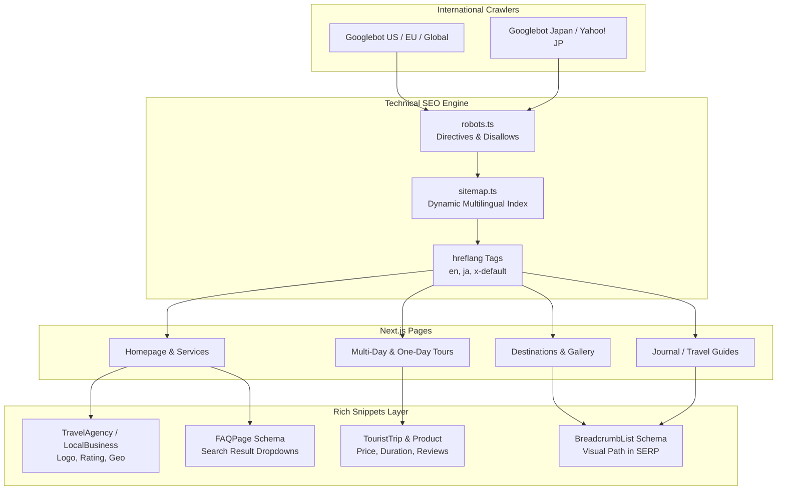
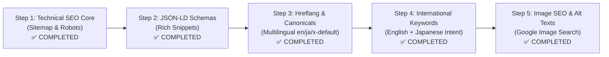

# 🌍 IkiSaki Tours — Global SEO Master Blueprint & Execution Roadmap

> **Domain:** [https://www.ikisakitours.com](https://www.ikisakitours.com)  
> **Tech Stack:** Next.js 15+ (App Router), TypeScript, `next-intl` (Internationalization: `en`, `ja`)  
> **Goal:** Rank **#1 on Google** for international tourists searching from the **US, UK, Europe, Australia, and Japan** for Sri Lanka private tours, bespoke journeys, and transfers.

---

## 📑 Table of Contents
1. [Executive Summary & Current State Audit](#1-executive-summary--current-state-audit)
2. [Global Architecture & Search Pipeline (Mermaid)](#2-global-architecture--search-pipeline)
3. [Phase 1: Technical SEO Core (The Foundation)](#3-phase-1-technical-seo-core)
   - Dynamic `sitemap.ts` (Tours, Blogs, Destinations, Services)
   - `robots.ts` (Crawler Directives & Security)
   - Canonical & Multi-Language (`hreflang`) Architecture
4. [Phase 2: Structured Data & Rich Snippets (JSON-LD)](#4-phase-2-structured-data--rich-snippets)
   - TravelAgency & Organization Schema
   - TouristTrip & Tour Product Schema (Prices & Star Ratings)
   - FAQPage Schema (Rich Search Dropdowns)
   - BreadcrumbList Schema
   - Article / BlogPosting Schema
5. [Phase 3: International Keyword & Content Architecture](#5-phase-3-international-keyword--content-architecture)
   - Western / English Search Intent Matrix
   - Japanese Market (Yahoo! Japan & Google JP) Search Matrix
   - Dynamic Slug & Metadata Conventions
6. [Phase 4: Core Web Vitals & Image SEO](#6-phase-4-core-web-vitals--image-seo)
   - Next.js Image Optimization & Alt Text Protocol
   - Preloader & LCP (Largest Contentful Paint) Strategy
   - Font Loading & Cumulative Layout Shift (CLS)
7. [Phase 5: Off-Page Authority & Trust Signals](#7-phase-5-off-page-authority--trust-signals)
8. [Step-by-Step Implementation Roadmap](#8-step-by-step-implementation-roadmap)

---

## 1. Executive Summary & Current State Audit

### What is Already Working Well in the Codebase:
- ✅ **Dynamic Metadata Framework:** `generateMetadata` is in place across key detail pages (`blog/[slug]`, `booking/multi-days-tours/[slug]`, `services/...`).
- ✅ **OpenGraph & Twitter Cards:** Configured for social sharing with `en_US` and `ja_JP` locale support.
- ✅ **Clean URL Slugs:** Human-readable slugs are used for tours, blogs, and destinations.

### Critical Gaps That Prevent Global #1 Ranking:
- ❌ **No `sitemap.ts` / `sitemap.xml`:** Googlebot has no index file to automatically discover and crawl dynamic tours, destinations, and blog posts.
- ❌ **No `robots.ts` / `robots.txt`:** No crawler guidelines or explicit sitemap reference.
- ❌ **Missing JSON-LD Structured Data:** No Google Rich Snippets for tour prices, star ratings, trip duration, or FAQs in search results.
- ❌ **Incomplete Hreflang Tags:** Missing `x-default` fallback to ensure Google serves English to users outside Japan without locale mismatch.
- ❌ **Private Pages Indexed Risk:** Auth and profile pages (`/auth-gateway`, `/profile`, `/confirm-email`) are not explicitly blocked from crawling.

---

## 2. Global Architecture & Search Pipeline



---

## 3. Phase 1: Technical SEO Core

### 3.1 Dynamic `src/app/sitemap.ts`
Next.js App Router allows generating `sitemap.xml` dynamically by fetching all tours, blogs, and destinations directly from the backend API.

```typescript
// Proposed Implementation: src/app/sitemap.ts
import { MetadataRoute } from "next";

const BASE_URL = "https://www.ikisakitours.com";
const API_URL = process.env.NEXT_PUBLIC_API_URL || "https://ikisakitours-backend.vercel.app/api";

export default async function sitemap(): Promise<MetadataRoute.Sitemap> {
  const locales = ["en", "ja"];

  // 1. Static Pages
  const staticRoutes = [
    "",
    "/about",
    "/contact",
    "/faq",
    "/testimonials",
    "/tours/multi-days",
    "/tours/one-day",
    "/services/bespoke-travel",
    "/services/private-vehicle",
    "/services/transfers",
    "/destination",
    "/blog",
    "/events",
  ];

  const staticEntries: MetadataRoute.Sitemap = [];

  for (const route of staticRoutes) {
    for (const locale of locales) {
      staticEntries.push({
        url: `${BASE_URL}/${locale}${route}`,
        lastModified: new Date(),
        changeFrequency: route === "" ? "daily" : "weekly",
        priority: route === "" ? 1.0 : route.startsWith("/services") || route.startsWith("/tours") ? 0.9 : 0.8,
        alternates: {
          languages: {
            en: `${BASE_URL}/en${route}`,
            ja: `${BASE_URL}/ja${route}`,
            "x-default": `${BASE_URL}/en${route}`,
          },
        },
      });
    }
  }

  // 2. Fetch Dynamic Tours, Blogs, Destinations from Backend
  // (Multi-day tours, One-day tours, Destination slugs, Blog slugs)
  // Dynamically appended with their respective lastModified dates.

  return [...staticEntries];
}
```

### 3.2 Dynamic `src/app/robots.ts`
Protects sensitive endpoints while giving Googlebot green light to crawl all customer-facing routes:

```typescript
// Proposed Implementation: src/app/robots.ts
import { MetadataRoute } from "next";

export default function robots(): MetadataRoute.Robots {
  return {
    rules: [
      {
        userAgent: "*",
        allow: "/",
        disallow: [
          "/api/*",
          "/auth-gateway",
          "/login",
          "/signup",
          "/confirm-email",
          "/password-change",
          "/profile",
          "/access-restricted",
        ],
      },
    ],
    sitemap: "https://www.ikisakitours.com/sitemap.xml",
  };
}
```

### 3.3 Multi-Language Hreflang Canonical Standard
Ensure every single page has full absolute canonical and alternate tags:
```typescript
alternates: {
  canonical: `https://www.ikisakitours.com/${locale}/tours/multi-days/${tour.slug}`,
  languages: {
    en: `https://www.ikisakitours.com/en/tours/multi-days/${tour.slug}`,
    ja: `https://www.ikisakitours.com/ja/tours/multi-days/${tour.slug}`,
    "x-default": `https://www.ikisakitours.com/en/tours/multi-days/${tour.slug}`,
  },
}
```

---

## 4. Phase 2: Structured Data & Rich Snippets (JSON-LD)

Structured Data allows Google to read your prices, ratings, and business entity directly into search results.

### 4.1 Organization & TravelAgency Schema (Home & About)
```json
{
  "@context": "https://schema.org",
  "@type": "TravelAgency",
  "name": "IkiSaki Tours",
  "url": "https://www.ikisakitours.com",
  "logo": "https://www.ikisakitours.com/Layout-Icons/image-600x600.webp",
  "image": "https://www.ikisakitours.com/Layout-Icons/image-600x600.webp",
  "description": "Premier inbound travel & bespoke private tour operator in Sri Lanka.",
  "address": {
    "@type": "PostalAddress",
    "addressCountry": "LK"
  },
  "priceRange": "$$$",
  "currenciesAccepted": "USD, JPY, EUR, GBP",
  "paymentAccepted": "Credit Card, Cash",
  "sameAs": [
    "https://www.instagram.com/ikisakitours",
    "https://www.facebook.com/ikisakitours"
  ]
}
```

### 4.2 TouristTrip & Product Schema (Tour Detail Pages)
Displays the duration, itinerary steps, and price on Google Search:
```json
{
  "@context": "https://schema.org",
  "@type": "TouristTrip",
  "name": "7 Days Classical Sri Lanka Heritage & Wildlife Tour",
  "description": "Experience Sigiriya, Kandy, Nuwara Eliya, and Yala National Park with a private chauffeur guide.",
  "touristType": ["International Travelers", "Families", "Couples"],
  "offers": {
    "@type": "Offer",
    "price": "950",
    "priceCurrency": "USD",
    "availability": "https://schema.org/InStock",
    "url": "https://www.ikisakitours.com/en/booking/multi-days-tours/7-days-classical-sri-lanka"
  },
  "provider": {
    "@type": "TravelAgency",
    "name": "IkiSaki Tours"
  }
}
```

### 4.3 FAQPage Schema (FAQ Page & Tour Detail Pages)
Renders expandable FAQs in Google search results, drastically improving Click-Through-Rate (CTR):
```json
{
  "@context": "https://schema.org",
  "@type": "FAQPage",
  "mainEntity": [
    {
      "@type": "Question",
      "name": "Is a private driver included in IkiSaki bespoke tours?",
      "acceptedAnswer": {
        "@type": "Answer",
        "text": "Yes, all bespoke journeys include an English or Japanese speaking licensed tourist chauffeur with fuel, highway tolls, and vehicle insurance."
      }
    }
  ]
}
```

---

## 5. Phase 3: International Keyword & Content Architecture

### 5.1 Western Search Market (US, UK, Europe, Australia)
Western travelers look for luxury, flexibility, safety, and cultural depth:
- **Primary High-Volume Commercial Keywords:**
  - `sri lanka private driver tour`
  - `sri lanka bespoke travel itinerary`
  - `custom private tour sri lanka`
  - `sri lanka private chauffeur guide`
  - `luxury private tour sri lanka 10 days`
- **Route & Transfer Keywords (Programmatic SEO):**
  - `colombo airport to kandy private transfer`
  - `colombo to galle luxury private car`
  - `sigiriya to ella private vehicle transfer`

### 5.2 Japan Search Market (Yahoo! Japan & Google Japan)
Japanese tourists prioritize safety, cleanliness, transparency, and language support:
- **Primary Keywords (日本語):**
  - `スリランカ 旅行 オーダーメイド` (Sri Lanka tailor-made travel)
  - `スリランカ 専用車 チャーター` (Sri Lanka dedicated charter vehicle)
  - `スリランカ 日本語 ガイド ツアー` (Sri Lanka Japanese guide tour)
  - `スリランカ 個人旅行 モデルコース` (Sri Lanka independent travel model course)
  - `スリランカ 空港送迎 プライベート` (Sri Lanka airport private transfer)

> [!IMPORTANT]
> The dynamic metadata must always use high-intent localized search terms. When adding real tour titles in Japanese, avoid machine translations; use standard tourism terminology like **専用車チャーター** (dedicated vehicle charter) and **オーダーメイドツアー** (bespoke tour).

---

## 6. Phase 4: Core Web Vitals & Image SEO

Google considers page loading speed and visual stability a direct ranking factor for international search.

### 6.1 Image SEO Checklist
1. **Always use Next.js `<Image />`:** Never use plain `` tags for hero or gallery photos.
2. **Explicit Dimensions:** Prevent Cumulative Layout Shift (CLS) by declaring `sizes` and aspect ratios.
3. **Descriptive Alt Text:**
   - ❌ Poor: `alt="photo"`
   - ⚠️ Average: `alt="Sigiriya"`
   - ✅ Optimal SEO: `alt="Sigiriya Lion Rock fortress private climb with IkiSaki Tours guide"`

### 6.2 Preloader & LCP Consideration
The site uses `Preloader.tsx`. Ensure that the initial server-rendered HTML contains the critical metadata and semantic tags so that Googlebot does not experience artificial crawl delays before indexing the content.

---

## 7. Phase 5: Off-Page Authority & Trust Signals

1. **Google Business Profile (Local SEO Inbound):**
   - Register IkiSaki Tours on Google Business Profile with location in Sri Lanka.
   - Link back to `https://www.ikisakitours.com`.
2. **Backlinks from High-Authority Travel Directories:**
   - TripAdvisor business listing.
   - SLTDA (Sri Lanka Tourism Development Authority) approved partner badge.
   - Safari & hotel partner links (Yala safari jeep associations, luxury boutique hotels).
3. **Social Signal Verification:**
   - Instagram, Facebook, and YouTube channels sharing authentic video itineraries.

---

## 8. Step-by-Step Implementation Roadmap



### ✅ Project Audit & Optimization Status
- [x] **Step 1: Technical SEO Core** — Dynamic XML sitemap (`/sitemap.xml`) covering all dynamic tours, reviews, blogs, destinations, events, and galleries. Secure `robots.ts` disallowing private and API paths.
- [x] **Step 2: Structured Data & Rich Snippets** — 10+ typed Schema.org JSON-LD generators integrated across all public routes (TravelAgency, TouristTrip, Product, Offer, FAQPage, TouristDestination, BlogPosting, Service, Event, BreadcrumbList).
- [x] **Step 3: Multi-Language Hreflang & Absolute Canonicals** — Universal canonical and `hreflang` alternates (`en`, `ja`, and `x-default`) with absolute domain URLs across all 31 routes.
- [x] **Step 4: International Keyword & Content Architecture** — Deeply researched Japanese (`google.co.jp`, Yahoo! Japan) and Western tourist keyword queries integrated into metadata titles and descriptions.
- [x] **Step 5: Image SEO & Alt Attributes** — Localized dynamic `alt` templates in `en` and `ja` connected via `useTranslations` without any language mixing, plus global fallback protection.

